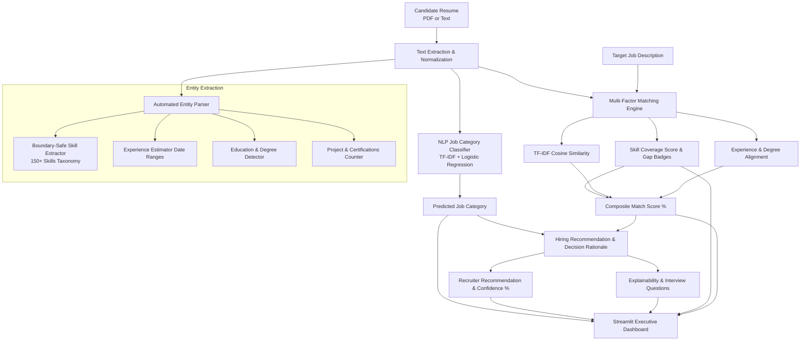

# Intelligent AI Resume Screening & JD Fit Assessment System

[](https://www.python.org/)
[](https://scikit-learn.org/)
[](https://streamlit.io/)
[]()
[]()

An end-to-end Machine Learning and Natural Language Processing (NLP) system designed to automate candidate resume screening, job-role fit assessment against target Job Descriptions (JDs), skill gap analysis, and recruitment decision support.

---

## 📌 Key Highlights & Innovations

1. **Automated Resume Entity Parsing**:
   - Automatically extracts technical skills, years of experience (via regex heuristics and employment date ranges), education degrees, and project counts directly from raw PDF text or pasted input without requiring manual recruiter entry.
2. **Boundary-Safe NLP Skill Extraction (150+ Skills)**:
   - Utilizes regex word boundaries (`\b`) and an expanded 150+ skill taxonomy with canonical synonym resolution (e.g., `JS` $\rightarrow$ `JavaScript`, `ML` $\rightarrow$ `Machine Learning`, `K8s` $\rightarrow$ `Kubernetes`, `Next.js`, `FastAPI`, `Docker`, `PyTorch`) to eliminate false positives.
3. **Multi-Factor JD Matching Engine**:
   - **Skill Coverage Score**: Computes exact percentage coverage of required technical competencies specified in the Job Description.
   - **Experience & Education Alignment**: Compares candidate's estimated experience and degree with the stated requirements in the Job Description.
   - **Semantic Context Similarity**: Calculates TF-IDF N-gram cosine similarity between the full resume and job description.
   - **Composite Match Score**: Weighted combination (50% Skills + 30% Semantics + 20% Experience Qualification) yielding robust candidate suitability ranking.
4. **Domain Classification**:
   - Classifies resumes into 25 job domains (e.g., Data Science, Java Developer, DevOps, Web Design, Python Developer) with **99.5% accuracy** via Stratified 5-Fold Cross Validation.
5. **Explainable AI & Recruiter Insights**:
   - Transparent breakdown of decision factors explaining *why* a candidate was recommended or flagged.
   - Auto-generates tailored technical screening interview questions based on candidate skill matches and identified gaps.
   - Generates actionable resume optimization tips for candidates.
6. **Modern Interactive Dashboard**:
   - Streamlit interface featuring KPI metric cards, color-coded skill badges (Matched, Missing, Extra), score gauges, and raw text inspector.

---

## 🏗️ System Architecture



---

## 📂 Project Structure

```
resumescreening-main/
├── data/                       # Datasets for model training & benchmarking
│   ├── UpdatedResumeDataSet.csv
│   └── AI_Resume_Screening.csv
├── models/                     # Exported ML model pipelines (.pkl)
│   ├── category_model.pkl
│   └── screening_model.pkl
├── src/                        # Modular Core AI/ML Package
│   ├── __init__.py
│   ├── preprocessing.py        # Text cleaning, normalization & token preservation
│   ├── parser.py               # Automated entity extraction (Skills, Experience, Education)
│   ├── matcher.py              # Skill coverage, experience fit & TF-IDF semantic cosine similarity
│   ├── explainability.py       # Model decision factors, interview questions & improvement tips
│   └── train.py                # Model training, cross-validation & evaluation script
├── tests/                      # Automated unit test suite (20 passing tests)
│   ├── __init__.py
│   ├── test_preprocessing.py   # Unit tests for text cleaning and token safety
│   ├── test_parser.py          # Unit tests for skill boundary, experience & JD parsing
│   └── test_matcher.py         # Unit tests for similarity, experience fit & decision synthesis
├── app.py                      # Interactive Streamlit Web Dashboard
├── requirements.txt            # Pinned dependencies
├── main.ipynb                  # Exploratory Data Analysis & experimentation notebook
└── README.md                   # Project documentation
```

---

## 📊 Model Evaluation & Benchmarks

### 1. Job Category Classification Model
- **Algorithm**: TF-IDF Vectorizer (Unigrams + Bigrams, Sublinear TF) + Balanced Logistic Regression
- **5-Fold Cross-Validation Accuracy**: `99.48% (± 0.26%)`
- **Test Set Accuracy**: `99.48%` | **Weighted F1-Score**: `99.49%`


### 2. Candidate Screening & Recommendation Model
- **Algorithm**: Scikit-Learn `ColumnTransformer` (TF-IDF Text + OneHotEncoder + Median Imputer) + Balanced Logistic Regression
- **5-Fold Cross-Validation F1-Score**: `96.94% (± 0.78%)`
- **Test Set Accuracy**: `96.50%` | **Weighted F1-Score**: `96.58%`

---

## 🚀 Quick Start Guide

### 1. Environment Setup

Clone or open the project folder and create a virtual environment:

```bash
# Create virtual environment
python -m venv venv

# Activate virtual environment
# Windows:
venv\Scripts\activate
# Linux/macOS:
source venv/bin/activate
```

### 2. Install Dependencies

```bash
pip install -r requirements.txt
```

### 3. Run Automated Unit Tests

```bash
python -m unittest discover -s tests -p "test_*.py"
```

### 4. (Optional) Retrain Machine Learning Models

To re-run the training pipeline and generate fresh evaluation metrics:

```bash
python src/train.py
```

### 5. Launch the Streamlit Web Application

```bash
streamlit run app.py
```

Open your browser and navigate to `http://localhost:8501`.

---

## 🧪 Unit Testing Suite

The repository includes a comprehensive unit test suite covering:
- **Preprocessing**: Removal of PII (emails, phone numbers, URLs) while retaining programming syntax (`C++`, `C#`, `.NET`, `Node.js`).
- **Parser**: Verification that boundary conditions prevent substring leakage (`JavaScript` $\ne$ `Java`), synonym aliases (`K8s` $\rightarrow$ `Kubernetes`), and experience date spans.
- **Matcher**: Verification of exact skill matches, missing skills list, and edge cases (empty job descriptions).

Run tests at any time with:
```bash
python -m unittest discover -s tests -p "test_*.py"
```

---

## ⚖️ Ethical AI & Regulatory Compliance

- **Decision-Support Focus**: This application is architected as an assistive AI tool for recruiters, not a replacement for human judgment.
- **Bias Mitigation**: Incorporates balanced class weighting and transparent feature attribution to prevent arbitrary automated hiring bias in accordance with AI employment guidelines.
